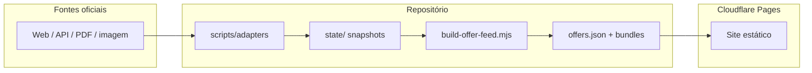

# Feira Boa

**Ofertas de supermercados em São João da Boa Vista** — catálogo estático, busca e filtros, tema claro/escuro, favoritos e alertas opcionais com conta.

[](https://feira-boa.pages.dev)
[](https://github.com/wendreof/feira-boa/actions/workflows/pull-request-checks.yml)


---

## O que é

Feira Boa reúne encartes e catálogos oficiais das redes da região em uma **PWA** rápida (HTML/CSS/TypeScript, sem framework de UI). Cada oferta aponta para o material-fonte; ofertas fora da validade impressa somem do feed público.

| Recurso | Descrição |
|--------|-----------|
| Busca e filtros | Produto, loja, setor, tipo, faixa de preço, ordenação |
| Cards | Preço atual, desconto, validade, condições, link para o encarte |
| Tema | Claro/escuro; sincroniza com a conta quando logado |
| Conta (opcional) | Favoritos, curtidas, alertas — [Supabase](https://supabase.com) + RLS |
| Alertas | Regras de preço via Telegram e/ou push (OneSignal / VAPID) |
| Monitoramento | Ingestão agendada, revisão de fonte e saúde das origens |

Detalhes de arquitetura, taxonomia e convenções: [`AGENT.md`](AGENT.md) e [`BACKEND_PLAN.md`](BACKEND_PLAN.md).

## Stack

- **Frontend:** TypeScript → `esbuild` → bundles na raiz (`app.js`, páginas dedicadas)
- **Dados:** adaptadores em `scripts/adapters/` → snapshots em `state/` → `offers.json`
- **Testes:** `node --test` + Playwright (UI)
- **Hospedagem:** [Cloudflare Pages](https://pages.cloudflare.com) — build `npm run build`, diretório de saída `.`
- **Auth / sync:** Supabase (chave publicável no cliente; segredos só em Actions ou Edge Functions)



## Início rápido

Requisito: **Node.js 24** (mesma versão do CI em `.github/workflows/pull-request-checks.yml`).

```bash
git clone https://github.com/wendreof/feira-boa.git
cd feira-boa
npm ci
npm run build
npm run typecheck
npm test
```

Servir localmente para checagens de UI:

```bash
npm run build
node scripts/dev-static-server.mjs   # http://127.0.0.1:8790
```

O feed publicado vem dos snapshots em `state/`; `src/offers.ts` é apenas fallback de desenvolvimento quando não há snapshot.

## Scripts principais

| Comando | Uso |
|---------|-----|
| `npm run build` | Typecheck parcial, gera `offers.json`, structured data, bundles `esbuild`, verifica artefatos |
| `npm run typecheck` | `tsc` em modo verificação |
| `npm test` | Testes unitários e de domínio (`tests/**/*.test.mjs`) |
| `npm run test:ui` | Suite Playwright (expiração, arquivo, logos, termos, etc.) |
| `npm run test:expiry-ui` / `test:archive-ui` / `test:logos` | Checagens Playwright individuais |
| `npm run ingest:offers` | Busca fontes oficiais e atualiza `state/` |
| `npm run agent:ingest` | Validação pós-ingestão manual (encartes curados) |
| `npm run monitor:sources` | Registra saúde das fontes |
| `npm run review:source` | Fluxo de revisão após mudança de fonte |
| `npm run check:site` | Saúde do site em produção (`SITE_URL`) |
| `npm run build:social-card` | Gera `social-card.png` (requer Chrome ou Edge local) |
| `npm run build:icons` | Ícones PWA |
| `npm run send:price-alerts` / `:dry` | Disparo de alertas (CI / operação) |
| `npm run send:catalog-push` / `:dry` | Push de catálogo |
| `npm run telegram:setup` | Configuração do bot Telegram |

Playwright: instale o Chromium uma vez com `npx playwright install chromium`. Testes de logo opcionais: `FEIRA_E2E_EMAIL` e `FEIRA_E2E_PASSWORD` no ambiente (nunca commitar).

## Dados e ingestão

Adaptadores em `scripts/adapters/` montam o catálogo a partir de fontes oficiais. Lojas monitoradas incluem **Sempre Vale**, **Big Bom**, **Pague Menos**, **Spasso Sabores**, **Corso**, **Spani** e **Forte Mix** (lista e URLs em [`docs/OFFER_SOURCE_INVENTORY.md`](docs/OFFER_SOURCE_INVENTORY.md) quando aplicável).

| Tipo de fonte | Atualização |
|---------------|-------------|
| API / página estruturada | Automática no `ingest:offers` (ex.: Pague Menos VTEX) |
| PDF / site scrape | Adaptadores dedicados (ex.: Big Bom, Spani) |
| Encarte em imagem | **Corso** e **Spasso**: pipeline com Gemini (`*-gemini.mjs`) e dados curados |
| Campanhas WhatsApp / app | **Forte Mix**: JSON manual em `scripts/adapters/data/fortemix-campaigns.json` |

Encartes curados (imagem/PDF): fluxo documentado em [`.agents/skills/offer-ingestion/SKILL.md`](.agents/skills/offer-ingestion/SKILL.md).

**Agendamento (GitHub Actions):** o workflow `monitor-offers.yml` roda **quatro vezes ao dia** (06:00, 09:00, 15:00 e 18:00, America/Sao_Paulo), ingere, commita `offers.json` + `state/` e dispara deploy na Cloudflare. `needs_review` em uma fonte bloqueia **alertas de preço**, não o feed público.

Ofertas do Pague Menos vêm do catálogo online e podem divergir da loja física — o site exibe esse aviso.

## Testes e qualidade

Antes de abrir PR ou publicar:

```bash
npm run typecheck
npm run build
npm test
npm run test:ui    # após npx playwright install chromium
```

O workflow **Pull request checks** executa typecheck, build e `npm test` em cada PR para `main` e `develop`.

## Deploy

- **Produção:** https://feira-boa.pages.dev — [Cloudflare Pages](https://pages.cloudflare.com) com `npm run build` e pasta `.` como diretório de saída.
- `build-info.json` é gerado no build e não vai para o Git; confira `/build-info.json` no deploy após mudanças de pipeline.
- Outros workflows: `send-price-alerts.yml`, `send-catalog-push.yml`, `check-site-health.yml`, `telegram-link-sync.yml`.

## Contas, alertas e admin

Resumo; passo a passo completo permanece nas migrações `supabase/migrations/` e em `AGENT.md`.

- **Login:** `login.html` — e-mail/senha e Google OAuth (configuração no console Supabase, não no código).
- **Páginas:** `account.html`, `alertas.html`, `admin.html` (painel somente leitura para usuários em `admin_users`).
- **Alertas:** Telegram (`telegram-webhook`) e push; segredos (`SUPABASE_SERVICE_ROLE_KEY`, `TELEGRAM_BOT_TOKEN`, `ONESIGNAL_REST_API_KEY`, chaves VAPID) apenas em GitHub Actions ou secrets do Supabase — nunca no bundle do navegador.

## Contribuir

1. Fork / branch a partir de `main` ou `develop`.
2. `npm ci` → typecheck → build → testes (e `test:ui` se alterar UI).
3. Abra PR; o CI deve passar.

Licença **MIT** — veja [`LICENSE`](LICENSE).

## Links úteis

- [AGENT.md](AGENT.md) — guia para agentes e mantenedores
- [BACKEND_PLAN.md](BACKEND_PLAN.md) — decisões de backend e deploy
- Fontes citadas no README anterior: [Sempre Vale](https://www.semprevale.com.br/ofertas.php), [Big Bom](https://bigbom.com.br), [Pague Menos SJDV](https://www.superpaguemenos.com.br/ofertas?productclusterids=161), [Spasso Sabores](https://spassosabores.com.br/ofertas-sao-joao/), [Corso](https://corso.com.br/jornalfrente.php)
