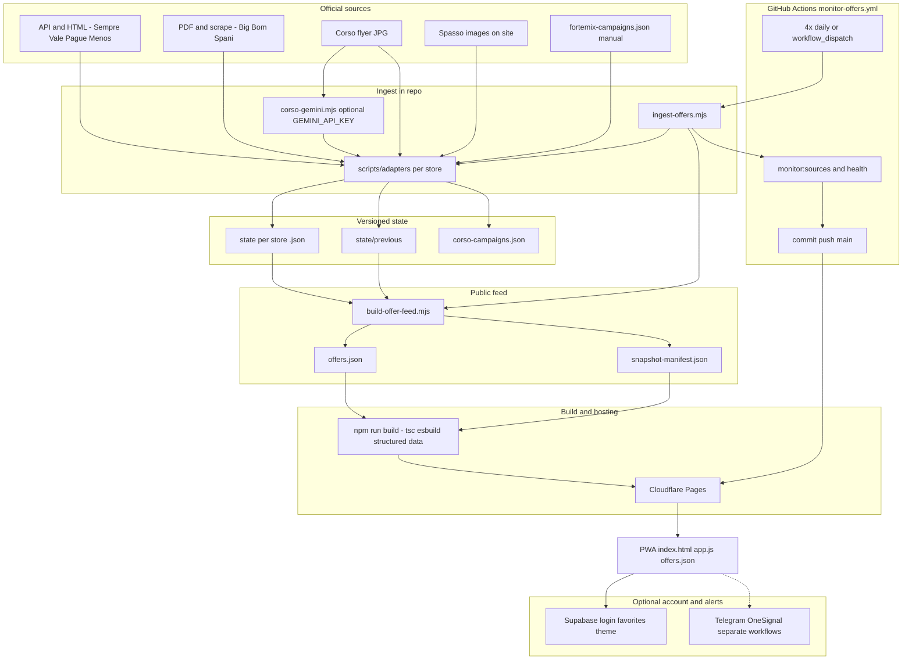

# Feira Boa

**Supermarket deals in São João da Boa Vista** — static catalog, search and filters, light/dark theme, favorites, and optional alerts with an account.

[](https://feira-boa.pages.dev)
[](https://github.com/wendreof/feira-boa/actions/workflows/pull-request-checks.yml)
[](https://codecov.io/gh/wendreof/feira-boa)

[](LICENSE)

[](https://feira-boa.pages.dev)

---

## What it is

Feira Boa aggregates official flyers and catalogs from regional chains in a **fast PWA** (HTML/CSS/TypeScript, no UI framework). Each offer links back to its source material; offers past their printed validity drop out of the public feed.

| Feature | Description |
|--------|-------------|
| Search and filters | Product, store, aisle, type, price range, sort order |
| Cards | Current price, discount, validity, conditions, link to the flyer |
| Theme | Light/dark; syncs with the account when signed in |
| Account (optional) | Favorites, likes, alerts — [Supabase](https://supabase.com) + RLS |
| Alerts | Price rules via Telegram and/or push (OneSignal / VAPID) |
| Monitoring | Scheduled ingest, source review, and origin health checks |

Architecture, taxonomy, and conventions: [`AGENT.md`](AGENT.md).

## Stack

- **Frontend:** TypeScript → `esbuild` → root bundles (`app.js`, dedicated pages)
- **Data:** adapters in `scripts/adapters/` → snapshots in `state/` → `offers.json`
- **Tests:** `node --test` + Playwright (UI)
- **Hosting:** [Cloudflare Pages](https://pages.cloudflare.com) — build `npm run build`, output directory `.`
- **Auth / sync:** Supabase (publishable key in the client; secrets only in Actions or Edge Functions)

The flow below connects **official sources** → **adapters** → **snapshots and feed** → **static build** → **Cloudflare Pages** → **PWA** in the browser. Local ingest: `npm run ingest:offers`; production runs the same path on a scheduled workflow.



**At a glance:** each adapter writes or preserves `state/<store>.json`; ingest calls `build-offer-feed.mjs` when finished. Cloudflare deploy runs `npm run build` (rebuilds the feed from `state/` and bundles JS). Account and alerts are an optional client layer — they are not part of `offers.json`.

## Quick start

Requires **Node.js 24** (same version as CI in `.github/workflows/pull-request-checks.yml`).

```bash
git clone https://github.com/wendreof/feira-boa.git
cd feira-boa
npm ci
npm run build
npm run typecheck
npm test
```

Serve locally for UI checks:

```bash
npm run build
node scripts/dev-static-server.mjs   # http://127.0.0.1:8790
```

The published feed comes from snapshots in `state/`; `src/offers.ts` is a development fallback when no snapshot is present.

## Main scripts

| Command | Purpose |
|---------|---------|
| `npm run build` | Partial typecheck, generates `offers.json`, structured data, `esbuild` bundles, verifies artifacts |
| `npm run typecheck` | `tsc` in check mode |
| `npm test` | Unit and domain tests (`tests/**/*.test.mjs`) |
| `npm run test:ui` | Playwright suite (expiry, archive, logos, terms, etc.) |
| `npm run test:expiry-ui` / `test:archive-ui` / `test:logos` | Individual Playwright checks |
| `npm run ingest:offers` | Fetch official sources and update `state/` |
| `npm run agent:ingest` | Post-ingest validation for manual flyers |
| `npm run monitor:sources` | Record source health |
| `npm run review:source` | Review flow after a source change |
| `npm run check:site` | Production site health (`SITE_URL`) |
| `npm run build:social-card` | Generate `social-card.png` (needs local Chrome or Edge) |
| `npm run build:icons` | PWA icons |
| `npm run send:price-alerts` / `:dry` | Price alert dispatch (CI / ops) |
| `npm run send:catalog-push` / `:dry` | Catalog push |
| `npm run telegram:setup` | Telegram bot setup |

Playwright: install Chromium once with `npx playwright install chromium`. Optional logo tests: set `FEIRA_E2E_EMAIL` and `FEIRA_E2E_PASSWORD` in the environment (never commit them).

## Data and ingest

Adapters in `scripts/adapters/` build the catalog from official sources. Monitored chains include **Sempre Vale**, **Big Bom**, **Pague Menos**, **Spasso Sabores**, **Corso**, **Spani**, and **Forte Mix** (list and URLs in [`docs/OFFER_SOURCE_INVENTORY.md`](docs/OFFER_SOURCE_INVENTORY.md) when applicable).

| Source type | Update path |
|---------------|-------------|
| API / structured page | Automatic in `ingest:offers` (e.g. Pague Menos VTEX) |
| PDF / site scrape | Dedicated adapters (e.g. Big Bom, Spani) |
| Image flyers | **Corso** and **Spasso**: Gemini pipeline (`*-gemini.mjs`) plus curated data |
| WhatsApp / app campaigns | **Forte Mix**: manual JSON in `scripts/adapters/data/fortemix-campaigns.json` |

Curated flyers (image/PDF): workflow in [`.agents/skills/offer-ingestion/SKILL.md`](.agents/skills/offer-ingestion/SKILL.md).

**Schedule (GitHub Actions):** workflow `monitor-offers.yml` runs **four times per day** (06:00, 09:00, 15:00, and 18:00 America/Sao_Paulo), ingests, commits `offers.json` + `state/`, and triggers Cloudflare deploy. `needs_review` on a source blocks **price alerts**, not the public feed.

Pague Menos offers come from the online catalog and may differ from the physical store — the site shows that notice.

## Tests and quality

Before opening a PR or shipping:

```bash
npm run typecheck
npm run build
npm test
npm run test:ui    # after npx playwright install chromium
```

The **Pull request checks** workflow runs typecheck, build, and `npm test` on every PR to `main` and `develop`.

## Deploy

- **Production:** https://feira-boa.pages.dev — [Cloudflare Pages](https://pages.cloudflare.com) with `npm run build` and output directory `.`.
- `build-info.json` is generated at build time and is not committed; check `/build-info.json` on deploy after pipeline changes.
- Other workflows: `send-price-alerts.yml`, `send-catalog-push.yml`, `check-site-health.yml`, `telegram-link-sync.yml`.

## Accounts, alerts, and admin

Summary only; full steps remain in `supabase/migrations/` and `AGENT.md`.

- **Login:** `login.html` — email/password and Google OAuth (configured in the Supabase console, not in code).
- **Pages:** `account.html`, `alertas.html`, `admin.html` (read-only panel for users in `admin_users`).
- **Alerts:** Telegram (`telegram-webhook`) and push; secrets (`SUPABASE_SERVICE_ROLE_KEY`, `TELEGRAM_BOT_TOKEN`, `ONESIGNAL_REST_API_KEY`, VAPID keys) only in GitHub Actions or Supabase secrets — never in the browser bundle.

## Contributing

1. Fork / branch from `main` or `develop`.
2. `npm ci` → typecheck → build → tests (and `test:ui` if you change UI). `npm run test:coverage` must meet **80%** lines/statements (c8); branches floor **75%** until adapter coverage grows.
3. Open a PR; CI must pass. From the CLI, `npm run pr:create` runs `gh pr create` with `.github/pull_request_template.md` (pass `--title`, `--base main`, etc. after `--`).

**MIT** license — see [`LICENSE`](LICENSE).

## Useful links

- [AGENT.md](AGENT.md) — guide for agents and maintainers (architecture, deploy, ingest)
- Official offer sources: [Sempre Vale](https://www.semprevale.com.br/ofertas.php), [Big Bom](https://bigbom.com.br), [Pague Menos SJDV](https://www.superpaguemenos.com.br/ofertas?productclusterids=161), [Spasso Sabores](https://spassosabores.com.br/ofertas-sao-joao/), [Corso](https://corso.com.br/jornalfrente.php)
